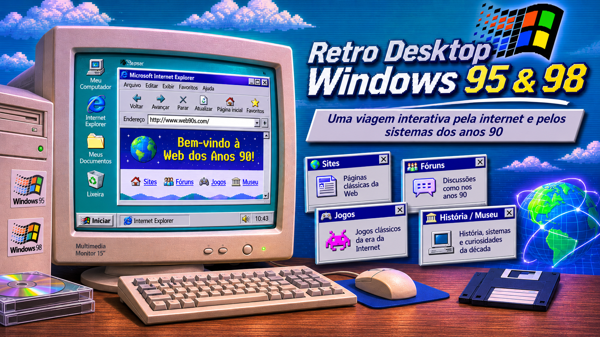
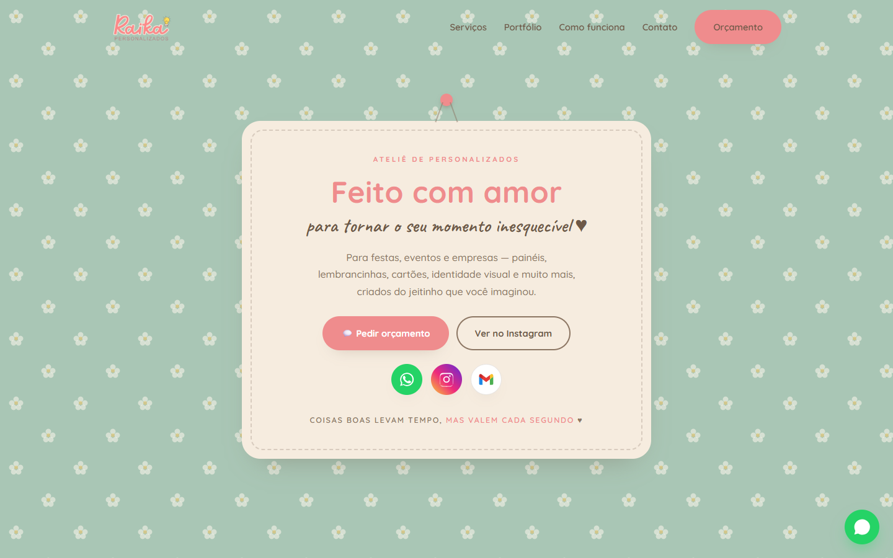

  

<h1 align="center">Nataniel Wilson</h1>

  Pode me chamar de <strong>NWOAN</strong> ou <strong>Natanashi</strong>.

  
  

---

## Sobre mim

Meu nome é Nataniel Wilson. Gosto de aprender colocando a mão no código e vendo uma ideia sair do papel até funcionar de verdade no navegador.

Ainda estou construindo meu caminho como desenvolvedor, então este perfil também é um registro dessa evolução. Cada repositório representa alguma coisa que eu quis entender melhor, testar ou transformar em algo que outras pessoas pudessem usar.

Tenho um carinho especial por interfaces bem cuidadas, experiências interativas e detalhes que fazem um projeto parecer vivo. Às vezes começo com uma ideia simples e vou melhorando aos poucos, corrigindo o que não ficou bom e aprendendo durante o processo.

## O que gosto de fazer

Gosto de criar para a web, trabalhar em interfaces que funcionem bem no computador e no celular e experimentar com animações, jogos e ideias visuais. Também me interesso pela parte mais estrutural dos projetos: organizar o código e conectar dados.

## Projeto em destaque

### Retro Desktop — Windows 95 & 98

Criei uma experiência interativa para revisitar os desktops do **Windows 95 e Windows 98**, direto no navegador. Dá para explorar janelas, abrir aplicativos e jogar clássicos como Campo Minado e Paciência, além de conhecer um pouco da história desses sistemas.

O projeto foi desenvolvido com **HTML, CSS e JavaScript**, com atenção aos detalhes visuais da época e à experiência de usar um computador antigo.

  <a href="https://retrodesk98.vercel.app/"><strong>Acessar o projeto Windows 95 & 98 no Vercel</strong></a>

## Experiência profissional

### Raika Personalizados

Desenvolvi o site da **Raika Personalizados**, uma empresa que cria produtos personalizados para festas, eventos e outros momentos especiais. O trabalho da empresa inclui cartões, topos de bolo, painéis, lembrancinhas, adesivos, etiquetas, embalagens e outros materiais feitos sob encomenda.

Nesse projeto, transformei a identidade visual e o catálogo da empresa em uma experiência web organizada, responsiva e fácil de usar. Estruturei a apresentação dos serviços, o portfólio de produtos e os caminhos de contato e orçamento. Foi uma experiência profissional importante para praticar criação de interfaces, adaptação para celular e desenvolvimento de um site voltado às necessidades reais de uma empresa.

  <a href="https://natanashi.github.io/raika-personalizados/"><strong>Visitar o site</strong></a>
  &nbsp;·&nbsp;
  <a href="https://github.com/natanashi/raika-personalizados"><strong>Ver o repositório</strong></a>

## Ferramentas que fazem parte do meu caminho

  
  
  
  
  
  
  
  
  

---

  Obrigado por passar por aqui. Se quiser acompanhar o que estou criando além do GitHub, me encontre no
  <a href="https://www.instagram.com/nataniel_wilson_/">Instagram</a>.

